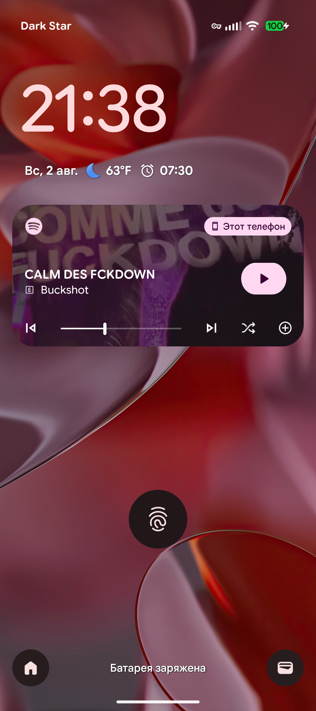
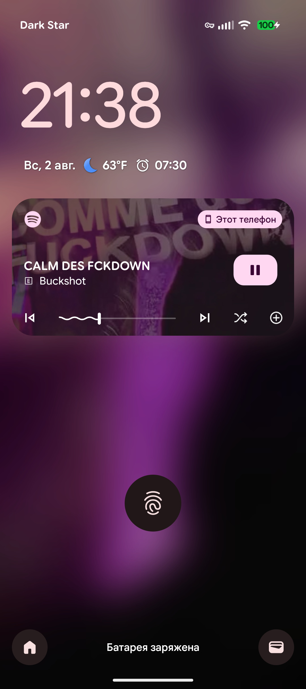

  

# Artlock

Artlock watches what song is currently playing, pulls the artwork, and sets it as your lock screen background, like the [good](https://www.androidpolice.com/album-art-wallpapers-should-never-have-been-removed-but-material-you-is-the-time-to-bring-it-back/) [ol'](https://9to5google.com/2020/08/02/android-11-lockscreen-art) [days](https://www.pcmag.com/news/report-android-11-scraps-lock-screen-album-art)!

|            Disabled            |             Enabled             |
|:------------------------------:|:-------------------------------:|
|            |            |

---
